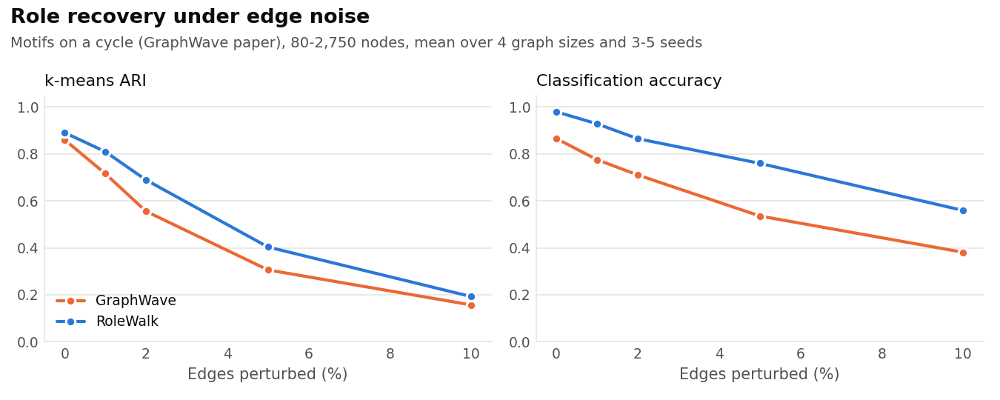
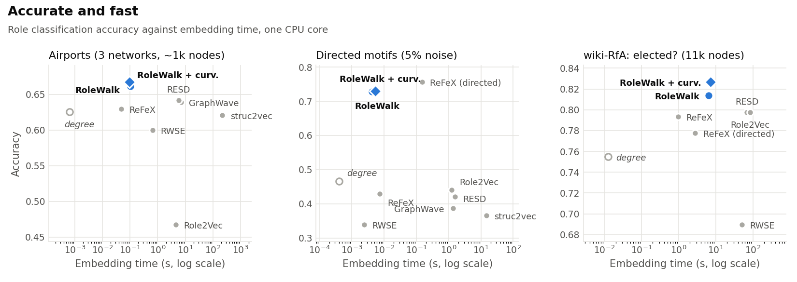
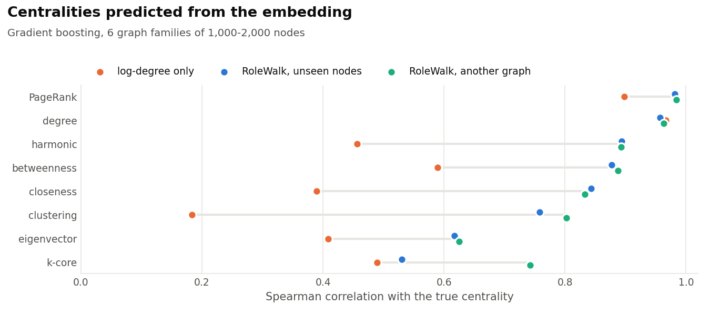
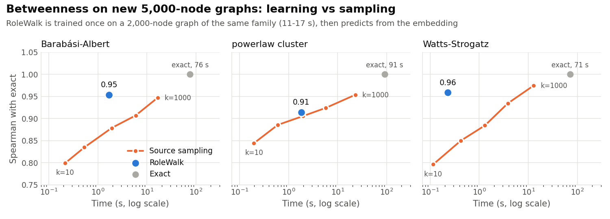
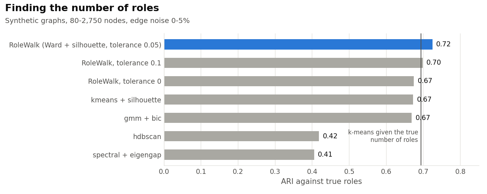

RoleWalk
========

**Fast, inductive structural role embeddings for directed and undirected
graphs.**

RoleWalk describes each node by the shape of the random walks that start from
it. Two nodes that play the same role (hub, bridge, leaf, clique member...)
get the same embedding, wherever they are in the graph, and in whatever
graph. From there, RoleWalk finds roles, describes them, saves them, and
labels new nodes live.

Highlights
----------

- **Better roles than GraphWave, 180-2,700x faster**, the gap growing with
  graph size. On the GraphWave paper's own benchmark (motifs on a cycle,
  with edge noise), RoleWalk recovers roles with an ARI of 0.60 against
  0.52, and embeds 2,750 nodes in 15 ms against 40 s.
- **Inductive.** A node's embedding only depends on its neighbourhood, so
  what is learned on one graph applies to another, with no retraining.
- **Predicts centralities it never computes.** From the embedding alone,
  gradient boosting ranks nodes by PageRank (0.98 Spearman), harmonic
  closeness (0.89) and betweenness (0.89), even on graphs it was not trained
  on.
- **Betweenness 10-15x faster than source sampling** at equal quality on
  two graph families out of three: trained once on a 2,000-node graph, it
  ranks the nodes of a new 5,000-node graph at 0.91-0.96 Spearman in
  0.2-1.8 s, where exact betweenness takes 71-91 s.
- **Roles, found and explained.** The number of roles is chosen from the
  data (or given), and `role_summary` describes each role in plain words:
  "high degree (top 3%), low clustering (bottom 10%)", "links to: 2 (40%),
  self (30%)".
- **Save once, label live.** A fitted model is a small `.npz` file;
  labelling a handful of nodes in a live graph takes milliseconds.
- **Scales.** A million nodes in 20 s to 3 min on one CPU core, with
  `numba` installed; rows are independent, so `n_jobs` threads divide that.

Install
-------

```bash
pip install rolewalk          # from PyPI
pip install "rolewalk[fast]"  # with numba: fused walk kernel, ~2x faster, low memory
```

Quickstart
----------

```python
import networkx as nx
from rolewalk import RoleWalk, role_summary

G = nx.balanced_tree(2, 6)

rw = RoleWalk()
X = rw.transform(G)            # one row per node, in G.nodes order
roles = rw.fit_predict(X)      # number of roles chosen from the data
roles7 = rw.fit_predict(X, n_roles=7)

print(role_summary(G, roles, X))
```

Directed graphs are embedded along both out- and in-edges; edge weights are
used as transition weights.

How it works
------------

For each node, RoleWalk takes the distribution of the transition
probabilities of a lazy random walk after 1, 2, ..., `walk_len` steps, and
samples its characteristic function: for each step, the sum of
`exp(i * theta * p) - 1` over the nodes the walk reaches, at `n_samples`
values of theta. The squared distance between two embeddings is then an MMD
between those distributions, so nodes whose walks spread the same way end up
close, whatever the nodes' identities.

Only the first `walk_len` sparse matrix powers are computed, and
probabilities below `tol=1e-4` are dropped as they appear, their mass being
added back to first order. This keeps the walks sparse around hubs at no
measurable cost in accuracy.

Finding roles
-------------

- `fit_predict(X, n_roles=k)` runs k-means (k-means++, `n_init=10`
  restarts).
- `fit_predict(X)` chooses the number of roles: a Ward hierarchy is built on
  a sample of 1,000 nodes, each cut from 2 to `max_n_roles` is scored by
  silhouette, the smallest number of roles within `tolerance=0.05` of the
  best silhouette is kept, and its centroids seed a k-means on all nodes.

`fit` does the same and returns the model; `n_roles_`, `cluster_centers_`
and `silhouette_scores_` are set afterwards.

When roles blend into each other (silhouettes around 0.3 and below), k-means
has several near-equivalent solutions and which one comes out depends on
node order. Raise `n_init` (e.g. to 200 on graphs of a few thousand nodes)
for stable roles.

Describing roles
----------------

`role_summary(G, labels, X=None)` returns a pandas DataFrame with one row per
role, largest first:

- `n_nodes`, `share`;
- median `degree` (`in_degree` and `out_degree` too if directed),
  `neighbor_degree` and `clustering`;
- `profile`: what sets the role apart, e.g. "high degree (top 3%), low
  clustering (bottom 10%)", for statistics whose median falls in the top or
  bottom quarter of all nodes;
- `links_to`: where the role's edges go, e.g. "self (50%), 6 (50%)";
- `examples`: the nodes closest to the role's centroid if `X` is given,
  otherwise the highest-degree ones.

Reusing roles
-------------

Roles fitted once can label other graphs, or the same graph later on:

```python
rw = RoleWalk().fit(G, n_roles=7)
rw.role_names = ["leaders", "core", ...]   # optional, saved with the model
rw.save("roles.npz")

rw = RoleWalk.load("roles.npz")
rw.predict(G_next_month)                       # every node
rw.predict(G_next_month, nodes=["a", "b"])     # only these: explores their
                                               # neighbourhoods, a few ms
```

The file is a plain `.npz` (parameters as JSON, role centroids as an array):
loading it never runs code. Build new graphs exactly as the training graph
was built (same edges, same weights), and refit when the network's structure
drifts. k-means numbers roles arbitrarily: name them after nodes typical of
each role rather than by number, so that names survive a refit.

On a month of French politicians' Twitter interactions (859 accounts),
7 roles fitted on the first half and saved labelled the second half with an
ARI of 0.90 against roles refitted on it, in 42 ms for the whole graph and
11 ms for 4 accounts.

Benchmarks
----------

All scripts are in `benchmarks/` (see its README); timings are on one CPU
core.

### Role recovery

<picture>
  <source media="(prefers-color-scheme: dark)" srcset="https://raw.githubusercontent.com/kerighan/rolewalk/master/docs/img/role_recovery-dark.png">
  
</picture>

<picture>
  <source media="(prefers-color-scheme: dark)" srcset="https://raw.githubusercontent.com/kerighan/rolewalk/master/docs/img/speed-dark.png">
  
</picture>

The GraphWave paper's setting (Donnat et al., KDD 2018): house, star,
clique, fan, diamond and tree motifs attached to a cycle, each node's role
being its position in its motif; 1-10% of edges are then removed and added
at random. Mean over noise levels 0-10% and seeds
(`synthetic_benchmark.py`):

| | k-means ARI | accuracy | mAP | time |
|---|---|---|---|---|
| **80-275 nodes** | | | | |
| GraphWave | 0.524 | 0.642 | 0.647 | 0.70 s |
| RoleWalk | **0.600** | **0.797** | **0.692** | **0.002 s** |
| **800-2,750 nodes** | | | | |
| GraphWave | 0.511 | 0.674 | 0.634 | 22.6 s (40 s at 2,750) |
| RoleWalk | **0.593** | **0.855** | **0.681** | **0.012 s** (0.015 s) |

Accuracy is a logistic regression on half the nodes, mAP the retrieval of
same-role nodes by embedding distance.

### Predicting centralities

<picture>
  <source media="(prefers-color-scheme: dark)" srcset="https://raw.githubusercontent.com/kerighan/rolewalk/master/docs/img/centrality-dark.png">
  
</picture>

Gradient boosting on the embedding, Spearman correlation with the true
centrality, 6 graph families of 1,000-2,000 nodes
(`centrality_benchmark.py`):

| centrality | log-degree only | RoleWalk, unseen nodes | RoleWalk, another graph |
|---|---|---|---|
| PageRank | 0.90 | **0.98** | **0.98** |
| harmonic | 0.46 | **0.89** | **0.89** |
| betweenness | 0.59 | **0.88** | **0.89** |
| closeness | 0.39 | **0.84** | **0.83** |
| clustering | 0.18 | **0.76** | **0.80** |
| eigenvector | 0.41 | **0.62** | **0.63** |
| k-core | 0.49 | **0.53** | **0.74** |

"Another graph" trains on one graph and predicts on another of the same
family: the embedding transfers with no loss. Trained on 2,000-node graphs
and applied to 20,000-node ones, betweenness is still ranked at 0.84-0.91.
Eigenvector centrality and k-cores depend on the graph's global core and are
the hardest to read from a few walk steps.

### Betweenness: learning vs sampling

<picture>
  <source media="(prefers-color-scheme: dark)" srcset="https://raw.githubusercontent.com/kerighan/rolewalk/master/docs/img/betweenness-dark.png">
  
</picture>

The usual way to estimate betweenness on large graphs is to run the
shortest-path searches from `k` sampled sources only. RoleWalk instead
learns it once on a small graph (a 2,000-node graph, 11-17 s including the
exact betweenness), then predicts it from the embedding. On new 5,000-node
graphs, Spearman correlation with the exact betweenness
(`betweenness_benchmark.py`):

| family | exact | RoleWalk | sampling, k=100 | k=300 | k=1000 |
|---|---|---|---|---|---|
| Barabási-Albert | 75.5 s | **0.953 (1.7 s)** | 0.879 (1.9 s) | 0.907 (5.9 s) | 0.947 (16.6 s) |
| powerlaw cluster | 91.1 s | **0.914 (1.8 s)** | 0.906 (2.0 s) | 0.924 (5.8 s) | 0.954 (23.1 s) |
| Watts-Strogatz | 71.2 s | **0.959 (0.2 s)** | 0.884 (1.3 s) | 0.934 (3.8 s) | 0.975 (12.9 s) |

At equal quality RoleWalk is about 10x faster on Barabási-Albert and 15x on
Watts-Strogatz graphs, and on par on clustered power-law graphs. Sampling
keeps the edge when exact values matter: it converges to the true
betweenness as `k` grows, whereas RoleWalk ranks nodes, plateaus around
0.91-0.96, and needs a training graph of the same family.

### Finding roles

<picture>
  <source media="(prefers-color-scheme: dark)" srcset="https://raw.githubusercontent.com/kerighan/rolewalk/master/docs/img/clustering-dark.png">
  
</picture>

ARI against true roles on the synthetic graphs, noise 0-5%
(`clustering_benchmark.py`):

| number of roles | method | ARI | time |
|---|---|---|---|
| given | **k-means** (`fit_predict`) | **0.694** | 0.07 s |
| given | Ward / GMM / Birch | 0.669-0.680 | 0.02-0.05 s |
| given | spectral clustering | 0.425 | 0.19 s |
| found | **Ward + silhouette, tolerance 0.05** (`fit_predict`) | **0.724** | 0.13 s |
| found | same, tolerance 0 | 0.674 | 0.13 s |
| found | k-means + silhouette | 0.672 | 1.56 s |
| found | GMM + BIC | 0.669 | 0.75 s |
| found | HDBSCAN | 0.418 | 0.08 s |
| found | spectral + eigengap | 0.405 | 0.19 s |

The best silhouette alone keeps too many roles under edge noise; the
tolerance trades a little silhouette for fewer, cleaner roles, and even beats
k-means told the true number of roles. Spectral clustering looks for
connected, arbitrarily shaped groups, whereas roles are compact blobs, often
of identical points. On graphs without a clear role structure (e.g.
scale-free graphs), few roles are found: ask for `n_roles` to split them
further.

### Speed

| graph | nodes | embedding |
|---|---|---|
| shapes on a cycle | 2,750 | 0.015 s |
| Barabási-Albert, m=3 | 20,000 | 2.6 s |
| random directed, mean degree 5 | 20,000 | 1.5 s |
| Barabási-Albert, m=2 | 100,000 | 5.7 s |
| powerlaw cluster, m=3 | 100,000 | 27 s |

On the 100,000-node powerlaw cluster graph, choosing the roles takes 0.6 s
and `role_summary` 1.5 s.

Parameters
----------

| parameter | default | |
|---|---|---|
| `walk_len` | 3 | walk steps; 3-4 covers most roles |
| `n_samples` | 10 | values of theta per step |
| `theta_scheme`, `bounds` | `"geomspace"`, (1, 100) | how theta is spread; log-spacing is robust to the upper bound under edge noise (`theta_study.py`) |
| `aggregate` | `"sum"` | `"mean"` (RoleWalk <= 1.1) averages over reached nodes only and loses how many there are: ARI 0.535 instead of 0.600 |
| `tol` | 1e-4 | probability pruning; 2-3.5x faster on hub-heavy graphs, pairwise distances correlated at 0.99999 with exact walks; 0 for exact walks |
| `shells` | True | adds, per step, the walk's probability mass in each "onion layer" (distance 0, 1, ... from the node): loops and triangles keep mass inside. Unsupervised role score 0.274 to 0.323 (`kernel_grid.py`), USA airports 0.628 to 0.657, same speed within 15%. Models saved before 1.3 load with `False` |
| `curvature` | False | adds the mean and spread of the curvature where the walk lands (overlap of the lazy walks at both ends of each edge, a probabilistic proxy of Ollivier-Ricci): tree-like vs clique-like neighbourhoods. Better roles within a graph (directed motifs 0.91 to 0.99), slightly worse transfer |
| `embedding_dim` | None | random projection, for plotting only: 2 dimensions drop accuracy from about 0.80 to 0.55 |
| `role_names` | None | names of fitted roles, saved with the model |
