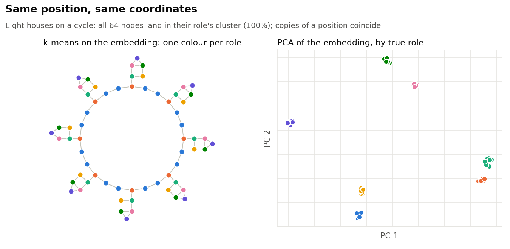
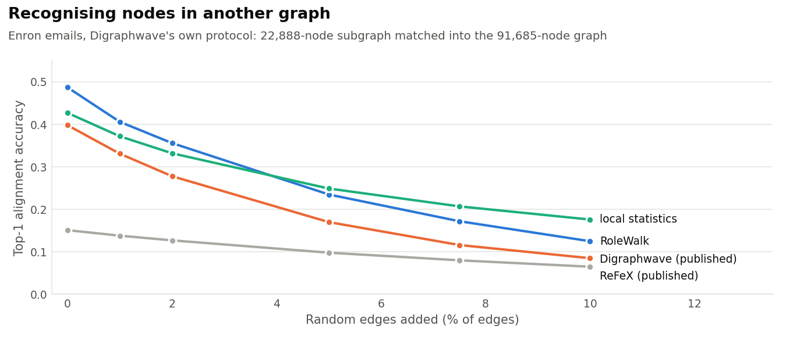
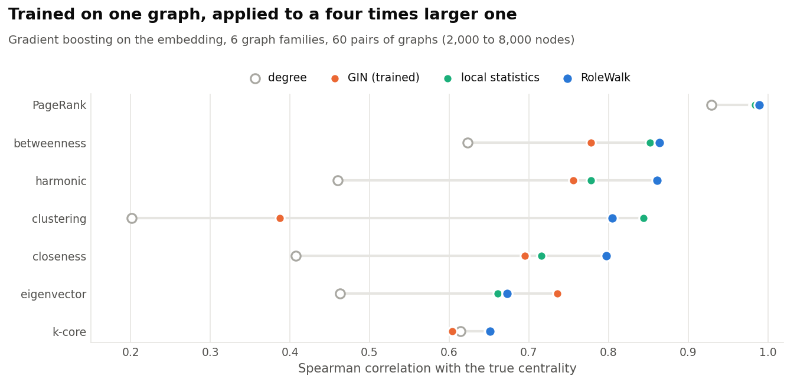
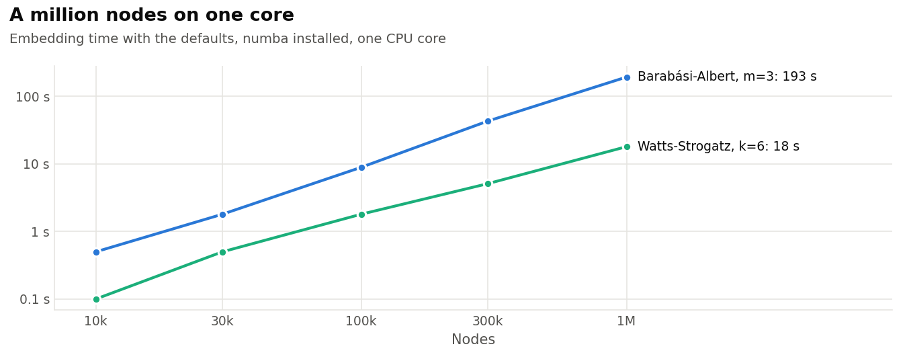

RoleWalk
========

**Training-free structural embeddings for directed and undirected graphs,
whose coordinates mean the same thing in every graph.**

RoleWalk describes each node by the shape of a short random walk that starts
from it. Two nodes that play the same role (hub, bridge, leaf, member of a
dense core...) get the same coordinates, wherever they are in the graph and
in whatever graph. From there, RoleWalk finds roles, describes them, saves
them, and labels nodes of new graphs live.

<picture>
  <source media="(prefers-color-scheme: dark)" srcset="https://raw.githubusercontent.com/kerighan/rolewalk/master/docs/img/roles-dark.png">
  
</picture>

- **No training, no graph-level quantity.** A node's coordinates depend
  only on its neighbourhood within a few steps, so embeddings computed on
  different graphs are directly comparable: a model trained on one graph
  applies to another.
- **Reads directions.** On directed graphs, walks follow out-edges and
  in-edges, and walks that go forward then back see who shares a node's
  targets or sources (two voters backing the same candidates).
- **Competitive and cheap.** In the leading group on five role
  classification benchmarks, for 0.2 s on a 1,190-node graph where
  GraphWave takes 18 s and struc2vec nearly 10 min.
- **Scales.** A million nodes in 18 s to 3.2 min on one CPU core, with an
  optional per-node error certificate for the pruned computation.

Install
-------

```bash
pip install rolewalk          # numpy, scipy, networkx, scikit-learn, pandas
pip install "rolewalk[fast]"  # with numba: fused walk kernel, faster, O(n) memory
```

Quickstart
----------

```python
import networkx as nx
from rolewalk import RoleWalk, role_summary

G = nx.karate_club_graph()

rw = RoleWalk()
X = rw.transform(G)            # one row per node, in G.nodes order
roles = rw.fit_predict(X)      # number of roles chosen from the data
roles4 = rw.fit_predict(X, n_roles=4)

print(role_summary(G, roles4, X))
```

`transform` accepts any networkx graph, directed or not, weighted or not
(weights are transition weights). The embedding has 69 coordinates on
undirected graphs and 178 on directed ones.

How it works
------------

RoleWalk runs a lazy random walk from each node: at each step the walker
stays put with probability 1/(d+1), d being the node's number of
neighbours, and otherwise follows an edge in proportion to its weight. After
each of `walk_len=3` steps, it reads two laws of the walker's position:

- **how concentrated the walk is**, through the characteristic function of
  its transition probabilities, `sum_j exp(i * theta * p_j) - 1`, at ten
  frequencies theta log-spaced in [1, 100]. A hub spreads its mass thinly
  over many nodes, a leaf keeps most of it. Only the probabilities count,
  not which nodes carry them, so the coordinates do not depend on node
  identities;
- **how far it has gone**, the probability mass at distance 0, 1, ...
  from the start (the "onion layers"). Loops and triangles keep the walker
  near its start; tree-like neighbourhoods let it move out.

On directed graphs, RoleWalk does this for the out-walk and the in-walk,
and adds the characteristic functions of the *mixed probes*, one step
forward then one back and the converse: nodes that share targets (or
sources) with the start.

The squared distance between two embeddings is a maximum mean discrepancy
between the two nodes' walk footprints under one fixed kernel, so nodes
whose walks spread the same way end up close. The embedding separates
graphs that the Weisfeiler-Leman test cannot (it counts triangles on
regular graphs), though the test also separates some nodes it confuses;
like every walk statistic, it cannot separate distance-regular graphs with
equal parameters.

Only the first `walk_len` walk steps are computed, one sparse row per node,
and probabilities below `tol=1e-4` are dropped as they appear. Pruning is
accurate on average but can be badly wrong on hubs, so RoleWalk records the
mass each node lost (`missing_`) and, without curvature and with at most
three steps, a bound on each node's error against the exact embedding
(`certificate_`). A mass budget (`max_missing=0.01`) caps that loss.

Results
-------

All figures come from the paper (Chenebaux, 2026, in preparation); the
scripts and every result file are in `benchmarks/`. Timings are on one CPU
core.

### Role classification

<picture>
  <source media="(prefers-color-scheme: dark)" srcset="https://raw.githubusercontent.com/kerighan/rolewalk/master/docs/img/speed-dark.png">
  
</picture>

Logistic regression on the embedding, mean accuracy over 50 splits:

| | Brazil | Europe | USA | Reality-call | Actor | time (USA) |
|---|---|---|---|---|---|---|
| RoleWalk | 0.743 | 0.583 | 0.657 | 0.860 | 0.487 | 0.2 s |
| RoleWalk + curvature | 0.741 | 0.596 | **0.666** | 0.860 | 0.485 | 0.2 s |
| struc2vec | 0.705 | 0.561 | 0.596 | - | - | 564 s |
| GraphWave | **0.769** | 0.561 | 0.587 | 0.860 | 0.481 | 18 s |
| RESD | 0.728 | 0.544 | 0.653 | 0.857 | 0.476 | 8 s |
| ReFeX | 0.691 | 0.576 | 0.622 | 0.851 | 0.478 | 0.1 s |
| Digraphwave | 0.724 | 0.593 | 0.641 | 0.859 | **0.488** | 1.1 s |
| local statistics | 0.716 | 0.584 | 0.616 | **0.862** | 0.486 | |
| *degree alone* | *0.756* | *0.554* | *0.567* | *0.858* | *0.476* | |

RoleWalk is in the leading group everywhere, with no method dominating;
its advantage is cost. Airport labels are activity quartiles and favour
degree-like features: on Brazil, the degree alone beats every embedding
but GraphWave.

### Real directed roles: Wikipedia adminship

On the wiki-RfA vote graph (11,377 users, 188k votes, unsigned and
unweighted), predicting from the graph alone:

| | A: elected? | B: voter, failed candidate or admin | time |
|---|---|---|---|
| RoleWalk + curvature | **0.827** | **0.944** | 7 s |
| RoleWalk | 0.814 | 0.940 | 7 s |
| RoleWalk, no mixed probes | 0.808 | 0.938 | 4 s |
| Digraphwave | 0.807 | 0.939 | 360 s |
| local statistics (in / out) | 0.814 | 0.941 | 3 s |
| RESD | 0.798 | 0.843 | 68 s |
| *in/out degree alone* | *0.755* | *0.922* | |

struc2vec and GraphWave do not run at this size. On the symmetrised graph,
task B falls from 0.940 to 0.863: directions carry the role.

### Recognising nodes in another graph

<picture>
  <source media="(prefers-color-scheme: dark)" srcset="https://raw.githubusercontent.com/kerighan/rolewalk/master/docs/img/alignment-dark.png">
  
</picture>

Digraphwave's own benchmark: each node of the internal Enron email subgraph
is matched to its nearest neighbour, by embedding, in the full email graph,
after random edges are added. RoleWalk runs with its defaults and is ahead
of Digraphwave's published accuracy at every noise level. Hand-made local
statistics (degrees, neighbour degrees, triangles, clustering...) are a
strong baseline here: on average they tie RoleWalk, which leads up to 3% of
added edges and falls behind beyond.

### Transfer to larger graphs

<picture>
  <source media="(prefers-color-scheme: dark)" srcset="https://raw.githubusercontent.com/kerighan/rolewalk/master/docs/img/transfer-dark.png">
  
</picture>

A gradient-boosting regressor is fitted from the embedding to a centrality
on one 2,000-node graph and evaluated on another graph of the same family,
four times larger. Over 60 pairs of graphs, RoleWalk has the best mean
Spearman correlation (0.813), against 0.790 for local statistics and frozen
ReFeX and 0.711 for a GIN trained on the training graph. What transfers is
mostly the law of the walker's distance. When the test graph instead
changes generator parameters (density, clustering...), local statistics do
better.

### Scale

<picture>
  <source media="(prefers-color-scheme: dark)" srcset="https://raw.githubusercontent.com/kerighan/rolewalk/master/docs/img/scale-dark.png">
  
</picture>

At most 2.5 GB of peak memory at a million nodes, most of it holding the
networkx graph. Rows are independent: `n_jobs` threads divide the time.
Among the baselines, only ReFeX also reaches a million nodes (faster than
RoleWalk).

### Limitations

- Simple hand-made features remain strong: ReFeX is faster, local
  statistics transfer better when generator parameters change and match
  RoleWalk on average on Enron alignment.
- Walk statistics cannot separate distance-regular graphs with equal
  parameters, nor graphs whose neighbourhoods coincide.
- Without a budget, pruning errors are only known after the fact, and can
  be large on hubs.

Finding roles
-------------

- `fit_predict(X, n_roles=k)` runs k-means (k-means++, `n_init=10`
  restarts).
- `fit_predict(X)` chooses the number of roles: a Ward hierarchy is built on
  a sample of 1,000 nodes, each cut from 2 to `max_n_roles` is scored by
  silhouette, the smallest number of roles within `tolerance=0.05` of the
  best silhouette is kept, and its centroids seed a k-means on all nodes.

`fit` does the same and returns the model; `n_roles_`, `cluster_centers_`
and `silhouette_scores_` are set afterwards.

When roles blend into each other (silhouettes around 0.3 and below), k-means
has several near-equivalent solutions and which one comes out depends on
node order. Raise `n_init` (e.g. to 200 on graphs of a few thousand nodes)
for stable roles. On graphs without a clear role structure (e.g. scale-free
graphs), few roles are found: ask for `n_roles` to split them further.

Describing roles
----------------

`role_summary(G, labels, X=None)` returns a pandas DataFrame with one row per
role, largest first:

- `n_nodes`, `share`;
- median `degree` (`in_degree` and `out_degree` too if directed),
  `neighbor_degree` and `clustering`;
- `profile`: what sets the role apart, e.g. "high degree (top 3%), low
  clustering (bottom 10%)", for statistics whose median falls in the top or
  bottom quarter of all nodes;
- `links_to`: where the role's edges go, e.g. "self (50%), 6 (50%)";
- `examples`: the nodes closest to the role's centroid if `X` is given,
  otherwise the highest-degree ones.

Reusing roles
-------------

Since coordinates do not depend on the graph, roles fitted once can label
other graphs, or the same graph later on:

```python
rw = RoleWalk().fit(G, n_roles=7)
rw.role_names = ["leaders", "core", ...]   # optional, saved with the model
rw.save("roles.npz")

rw = RoleWalk.load("roles.npz")
rw.predict(G_next_month)                       # every node
rw.predict(G_next_month, nodes=["a", "b"])     # only these: explores their
                                               # neighbourhoods, a few ms
```

The file is a plain `.npz` (parameters as JSON, role centroids as an array):
loading it never runs code. Build new graphs exactly as the training graph
was built (same edges, same weights), and refit when the network's structure
drifts. k-means numbers roles arbitrarily: name them after nodes typical of
each role rather than by number, so that names survive a refit.

Parameters
----------

| parameter | default | |
|---|---|---|
| `walk_len` | 3 | walk steps; 3-4 covers most roles |
| `n_samples` | 10 | frequencies theta per step |
| `theta_scheme`, `bounds` | `"geomspace"`, (1, 100) | how theta is spread |
| `shells` | True | the onion layers (law of the walker's distance) |
| `mixed` | True | directed graphs: mixed probes (shared targets and sources) |
| `curvature` | False | adds the mean and spread of an edge curvature where the walk lands (tree-like vs clique-like neighbourhoods); best scores on wiki-RfA and USA airports |
| `tol` | 1e-4 | probability pruning; 0 for exact walks |
| `max_missing` | None | mass budget per row for pruning, e.g. 0.01 |
| `walk` | `"mean_edge_loops"` | the lazy walk's self-loop weighs a mean edge (unit-invariant on weighted graphs), or 1 (`"unit_loops"`, the behaviour before 1.5) |
| `n_jobs` | 1 | threads for the fused walk (numba) |
| `embedding_dim` | None | random projection, for plotting only: low values lose role information |
| `role_names` | None | names of fitted roles, saved with the model |

Upgrading from 1.x
------------------

Version 2.0 replaces the 1.x API: `fit_transform(G)` is now `transform(G)`,
roles come from `fit` / `fit_predict` / `predict`, and the default embedding
adds the onion layers and, on directed graphs, the mixed probes.

License
-------

BSD 3-clause.
